# 2026-10-19

friendslop games with a twist?
simulator?
actually multiplayer or is it a solo game with "bots"?

webfishing, peak, amongus, meccha chameleon

---

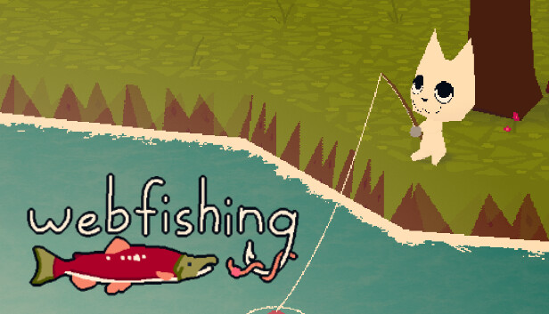

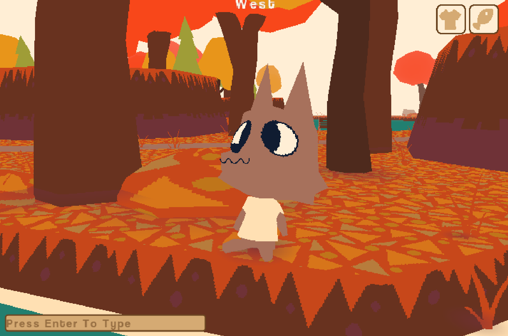

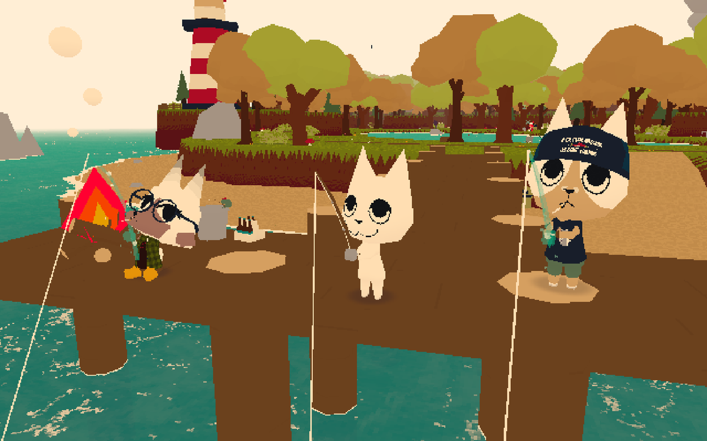

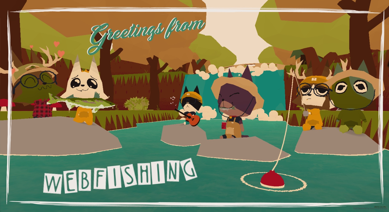

---

## Atlyss

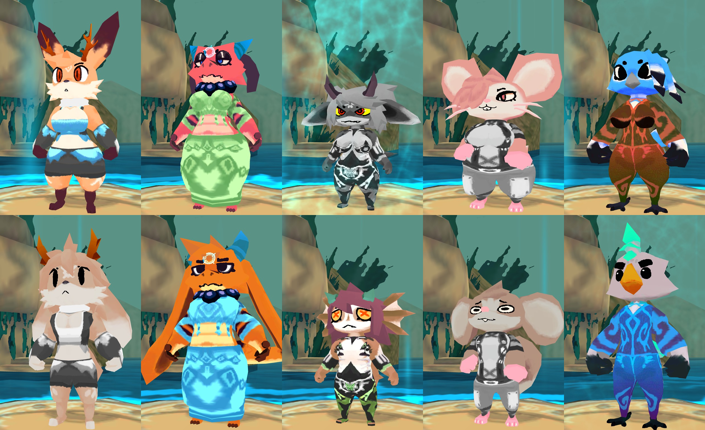

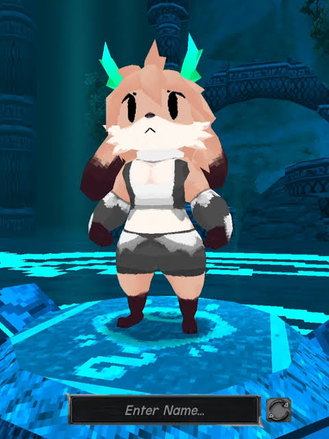

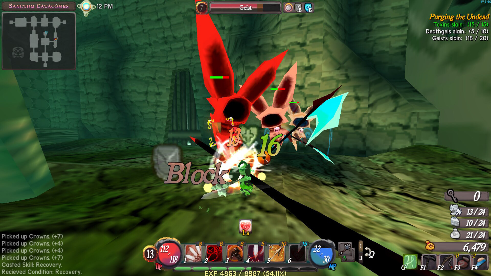

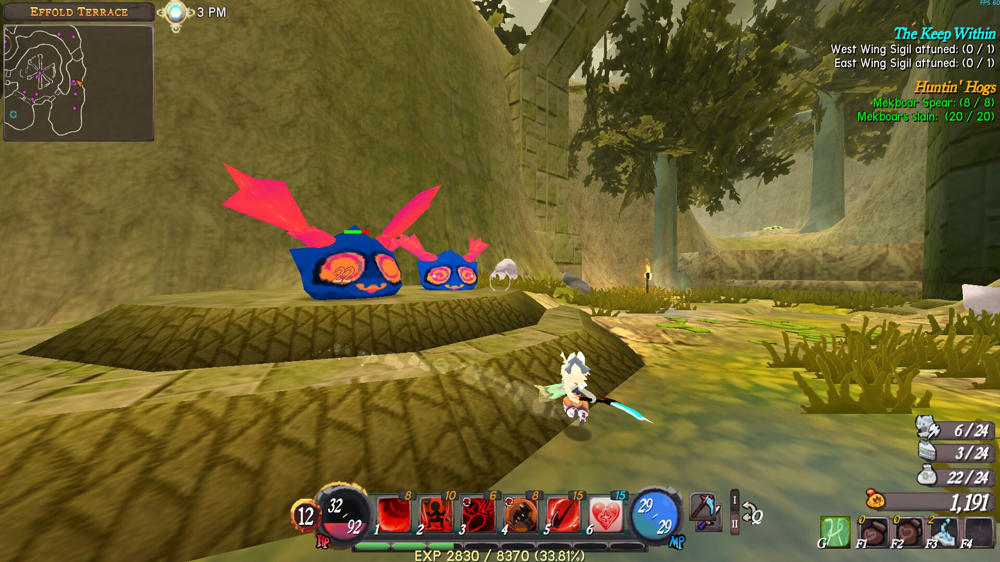

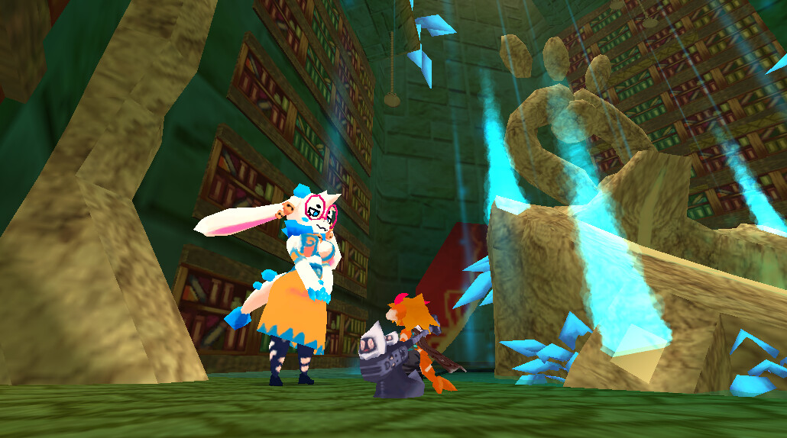

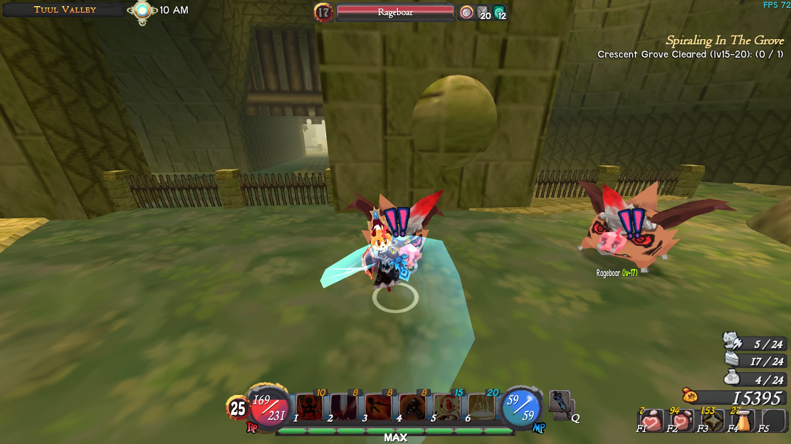

# List of Thoughts
## thought 1 – bystander –> 
single player game
you get thrown into this mmo

openworld and engaging
–>
you become a bystander – u see someone getting bullied – based on your action a story unfolds?

## thought 2 – seeing the unseen?
in the mmo world you bully the enemies

(slimes, rats, bats, skeletons, ...) by slaying/fighting them

-> you get to see their feelings / the side effects of your bullying -> bully (fight) enemy further? – stop – show sympath

## bloop

c:\Geneve\_HEAD_MMD_1\04_Creative_Coding\MMD1_CCC_CODE

## thought 3 – get SLIMED – RPG ENEMY TROPE thingy

playing as an slime enemy in an mmo word where you bully players. Frustrate them by your skills (can cheat)?

Frustration action level progression? actions the slime can do
- steeling items 
- not letting players escape from battle
- if a player escapes from battle the slime chases them
- attacking multiple turns in a turn eventough the game is a turnbase classic

Actual malice:

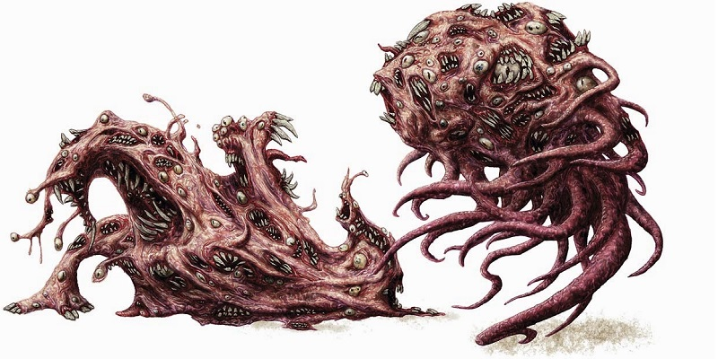